# 📄🎲 DocQ (Document + Quiz)

## 1️⃣ 프로젝트 개요

🎲 **개발 기간**

| 개발기간 | 2026.01.06 ~ 2026.02.13 (6주) |
| --- | --- |

 

🎲 **팀원 소개**

| 팀원 | 역할 |
| --- | --- |
| 김현수(팀장, BE) | 실시간 게임 서버 구조 설계, Redis 기반 이벤트 처리, 핵심 게임 로직 |
| 안성훈(Infra) | AWS 인프라 구축, CI/CD 파이프라인, Nginx 설정, AI 서버 스케일아웃 |
| 홍현기(AI) | PDF 분석 파이프라인, MinerU OCR·레이아웃 파싱, AI 퀴즈 생성 |
| 정인호(FE) | 프론트엔드 구조 설계, 게임 씬 전환 및 상호작용, 성능 최적화 |
| 오창민(FE) | UI/UX 엔지니어링, 반응성 디자인, 3D 모델링·애니메이션 |
| 임보경(FE) | UI 컴포넌트 구현, 프론트엔드 유지보수, UX 개선 |

 

🎲 **기획 의도**

| 많은 학습 및 업무 환경에서 PDF 문서는 필수적인 매체이지만, 내용이 방대하고 정적인 특성으로 인해 **집중력 저하와 피로감**을 유발하는 경우가 많습니다. |
| --- |
|“문서를 읽고 잘 이해했는지를 하나의 게임 경험으로 만들 수는 없을까? 라는 질문에서 출발한 서비스입니다. |

 
 
 

## 2️⃣ 서비스 소개

**DocQ(독큐)** 는 PDF 문서를 기반으로 퀴즈를 생성하고, 이를 

**🎲 보드게임 형태의 멀티플레이 퀴즈 게임**으로 즐길 수 있는 서비스입니다.

DocQ는 문서를 *처음 학습하기 위한 서비스*가 아니라,
 
**이미 읽은 문서의 내용을 얼마나 잘 이해했는지를 검증하는 데 초점**을 둡니다.

정적인 문서 읽기 이후,

퀴즈와 게임 요소를 통해 **이해도를 점검하고 기억을 환기하는 경험**을 제공합니다.

 
 
 

### 🎮 서비스 기능 소개

* **메인 페이지**

  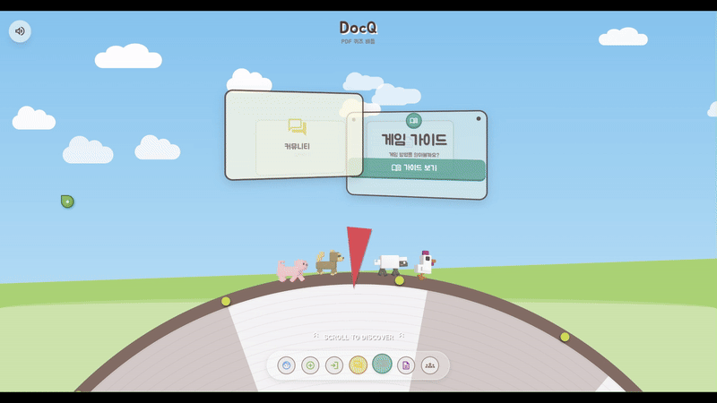

* **PDF 기반 AI 퀴즈 자동 생성**

  단순 텍스트 분해가 아닌 문서의 핵심 개념과 흐름을 중심으로 퀴즈를 생성합니다.

  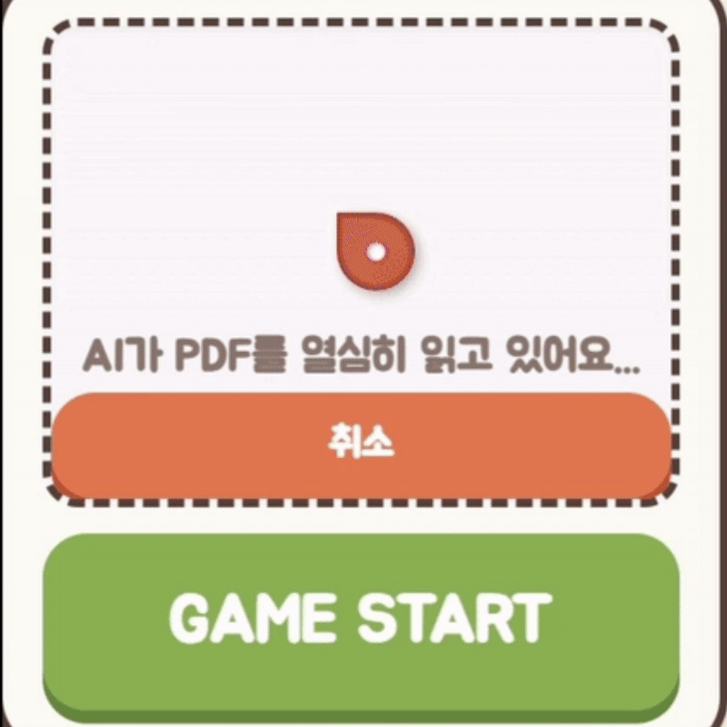

* **실시간 멀티플레이 게임**

  하나의 게임 룸에서 최대 4명이 동시에 참여하여 경쟁합니다.

  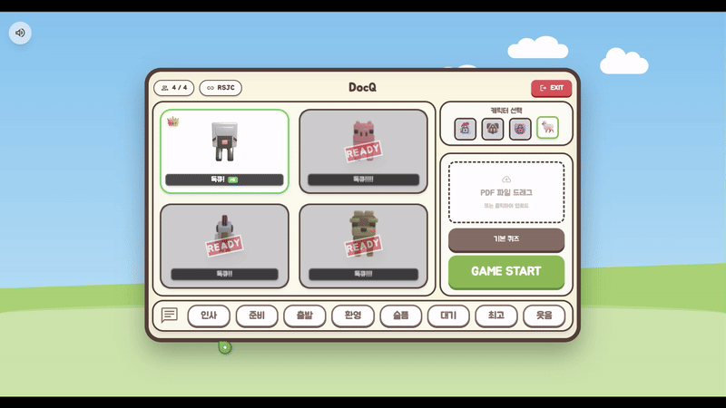

* **턴제 보드 게임 시스템**

  퀴즈를 맞힌 플레이어가 룰렛을 돌려 보드를 이동하며 게임을 진행합니다.

  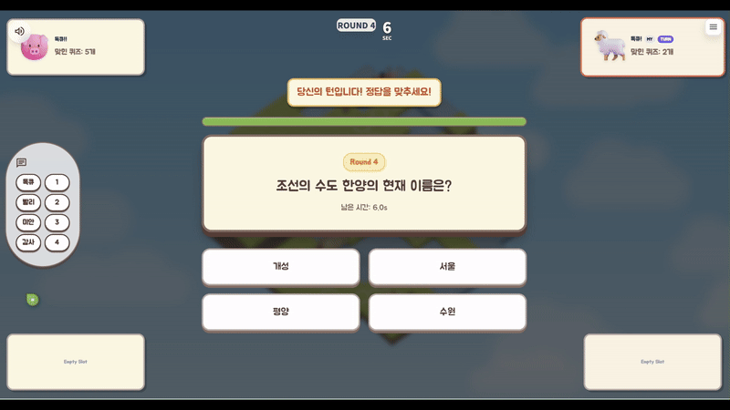
  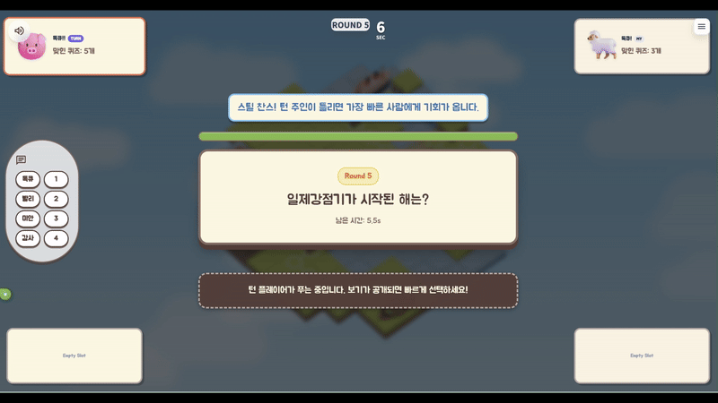
  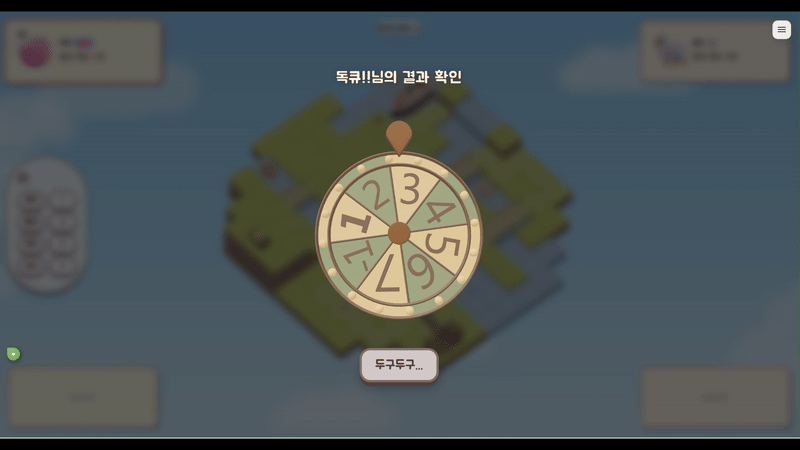
  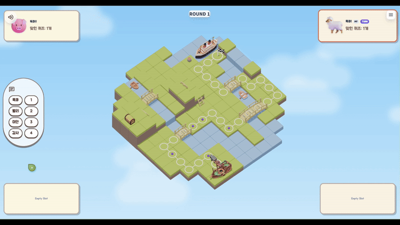

* **미니게임**

  미니게임을 통해 아이템을 얻고, 또다른 재미를 느낄 수 있습니다.

  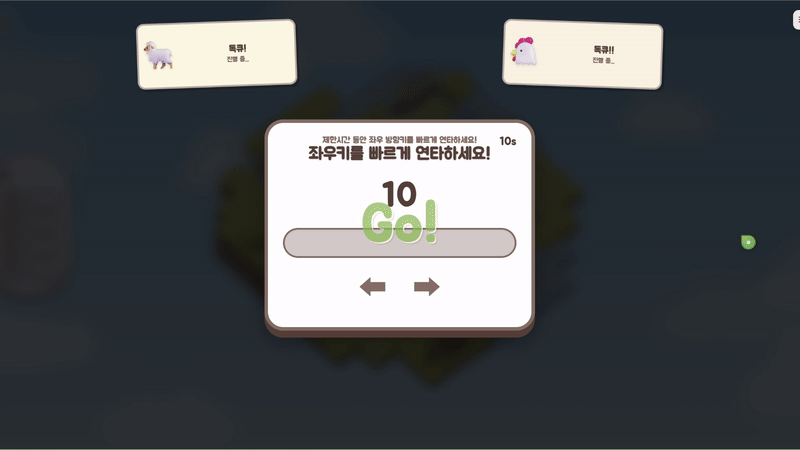
  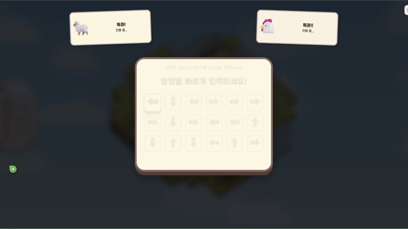

  

* **아이템**

  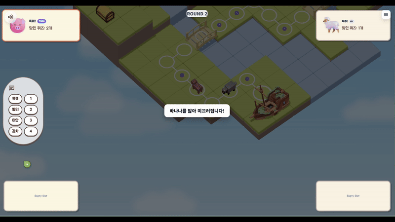
  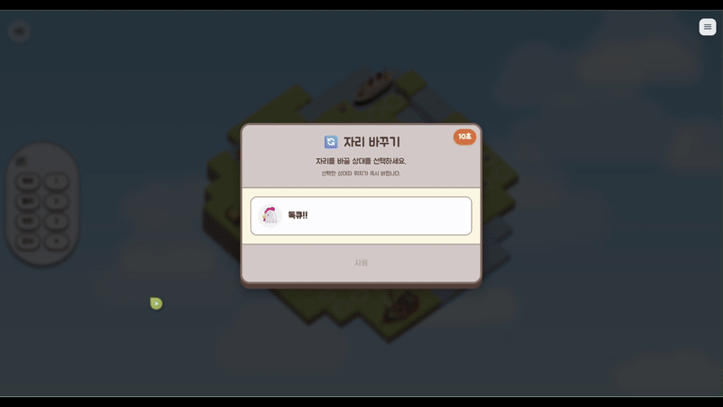

  

* **결과**

  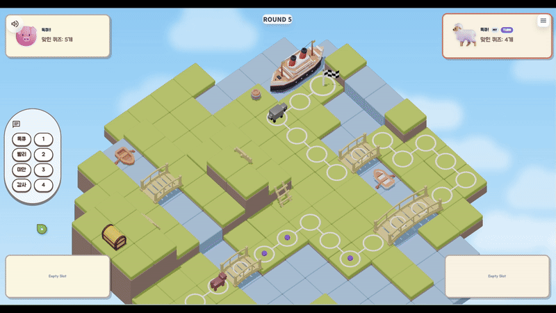

* **커뮤니티**

  유저끼리 PDF기반 퀴즈를 공유하고 저장할 수 있습니다.

  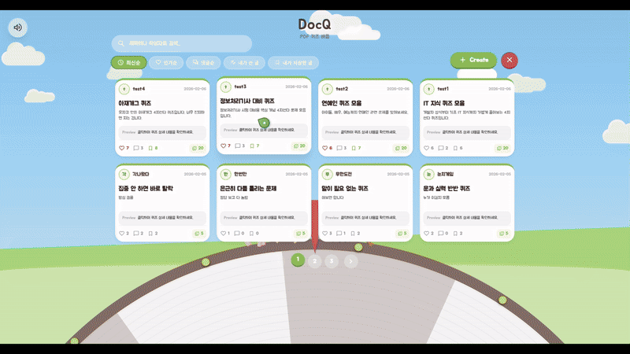

 
 
 

## 3️⃣ 개발 환경

**FE** | `Vue.js` `TypeScript` `Pinia` `TailwindCSS` `Three.js` `Blender`

**BE - API** | `Java` `SpringBoot` `JPA` `SpringSecurity` `MySQL`

**AI** | `Python` `FastAPI` `MinerU` `OpenAI`

**BE-GAME** | `Websocket` `STOMP` `Redis`

**CI/CD** | `AWS` `EC2` `RDS` `Docker` `Jenkins` `Nginx` `Docker Compose`

**협업 및 형상관리** | `GitLab` `Jira` `Mattermost`

 
 
 

## 4️⃣ 아키텍처

  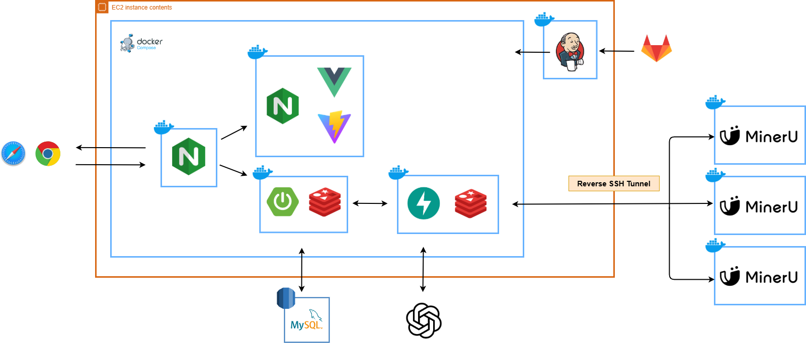
