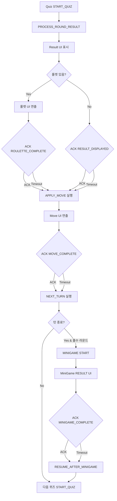

## Redis 도입 이후 유즈케이스 흐름

이 문서는 Redis 타임라인/락 기반 이벤트 처리 도입 이후,
프론트와 백엔드가 어떤 순서로 동작하는지 유즈케이스 관점으로 정리합니다.

---

## 공통 전제
- Redis ZSET(`game:events`)에 이벤트가 예약되고, 폴러가 due 이벤트를 처리한다.
- 백엔드는 최종 상태를 결정하고, 프론트는 표시/애니메이션을 담당한다.
- WebSocket은 상태/이벤트 브로드캐스트 경로이다.
- ACK는 Redis Set(`ack:{roomId}:{phase}:{key}`)으로 수집한다.
- `SADD`로 유저 ACK 저장, `SCARD`로 전체 인원 수 도달 시 다음 단계 진행
- ACK 완료 키: `ack:complete:{roomId}:{phase}:{key}` (중복 처리 방지)
- 실행 중복 방지 키: `exec:{roomId}:{eventType}:{key}` (이벤트 idempotency)
- 이벤트 예약/락/재시도 로직: `docq_backend/src/main/java/com/ssafy/docq_backend/domain/game/event/GameEventStore.java`
- 폴링 실행기: `docq_backend/src/main/java/com/ssafy/docq_backend/domain/game/event/GameEventPoller.java`
- 이벤트 라우터: `docq_backend/src/main/java/com/ssafy/docq_backend/domain/game/event/GameEventProcessor.java`

---

## 유즈케이스 1) 게임 시작

1. 프론트 → 서버
- `WS: /app/game/start` (방장 시작 요청)
- 수신 코드: `docq_backend/src/main/java/com/ssafy/docq_backend/domain/game/controller/GameController.java`

2. 서버 처리
- 방 상태를 `STARTING`으로 변경
- `START_QUIZ` 이벤트를 Redis에 예약 (인트로 딜레이 후)
- 처리 코드: `docq_backend/src/main/java/com/ssafy/docq_backend/domain/game/service/GameService.java` (`startGame`)

3. 서버 → 프론트
- `WS: /topic/game/{roomId}/state` 브로드캐스트

4. Redis 타임라인
- 폴러가 `START_QUIZ` 이벤트를 due 시점에 가져와 실행
- `startQuiz()` 호출
- 실행 코드: `docq_backend/src/main/java/com/ssafy/docq_backend/domain/game/event/GameEventProcessor.java`
- 호출 코드: `docq_backend/src/main/java/com/ssafy/docq_backend/domain/game/service/GameService.java` (`startQuiz`)

5. 서버 → 프론트
- `WS: /topic/game/{roomId}/quiz` (퀴즈 출제)
- `WS: /topic/game/{roomId}/state` (퀴즈 상태)

---

## 유즈케이스 2) 퀴즈 진행/채점

1. 프론트 → 서버
- `WS: /app/game/submit` (정답 제출)
- 수신 코드: `docq_backend/src/main/java/com/ssafy/docq_backend/domain/game/controller/GameController.java`

2. 서버 처리
- 제출 저장 (room.quizAnswers)
- 퀴즈 시작 시점에 예약된 `PROCESS_ROUND_RESULT` 이벤트가 Redis에서 실행됨
- 처리 코드: `docq_backend/src/main/java/com/ssafy/docq_backend/domain/game/service/GameService.java` (`submitAnswer`)

3. Redis 타임라인
- `PROCESS_ROUND_RESULT` 실행 → `processRoundResult()`
- 승자/이동값 계산, 라운드 결과 생성
- `APPLY_MOVE` 이벤트 예약 (결과 표시 ACK 기준)
- `NEXT_TURN` 이벤트 예약 (이동 완료 ACK 기준)
- 실행 코드: `docq_backend/src/main/java/com/ssafy/docq_backend/domain/game/event/GameEventProcessor.java`
- 처리 코드: `docq_backend/src/main/java/com/ssafy/docq_backend/domain/game/service/GameService.java` (`processRoundResult`)

4. 서버 → 프론트
- `WS: /topic/game/{roomId}/result` (라운드 결과)
- `WS: /topic/game/{roomId}/state` (판정 상태)
- 프론트는 결과 오버레이 종료 후 룰렛 연출(필요 시) 진행
- 룰렛 연출 완료 시 `ACK: ROULETTE_COMPLETE` 전송
- 룰렛이 없는 경우 `ACK: RESULT_DISPLAYED`로 바로 진행
- `ACK: RESULT_DISPLAYED`는 룰렛이 있는 경우에도 폴백 타이머 시작점으로 사용됨
- ACK 미수신 시 서버는 폴백 타임아웃 후 진행

---

## 유즈케이스 3) 이동 처리

1. Redis 타임라인
- `APPLY_MOVE` 이벤트 실행 → `applyMove()`
- 위치 업데이트, 잡기 처리, 버프 소모
- 실행 코드: `docq_backend/src/main/java/com/ssafy/docq_backend/domain/game/event/GameEventProcessor.java`
- 처리 코드: `docq_backend/src/main/java/com/ssafy/docq_backend/domain/game/service/GameService.java` (`applyMove`)

2. 서버 → 프론트
- `WS: /topic/game/{roomId}/move` (이동 정보)
- `WS: /topic/game/{roomId}/state` (MOVE 상태)

3. 프론트 처리
- 이동 애니메이션 표시
- UI 연출은 프론트에서 처리
- 처리 코드: `docq-frontend/src/components/game/board3D/GameBoard.vue`
- 이동 애니메이션 종료 후 `ACK: MOVE_COMPLETE` 전송
- ACK 미수신 시 서버는 거리 기반 폴백 타임아웃 후 진행 (`MOVE_FALLBACK_STEP_MS`, `MOVE_FALLBACK_BUFFER_MS`)

---

## 유즈케이스 4) 다음 턴 준비

1. Redis 타임라인
- `NEXT_TURN` 이벤트 실행 → `prepareNextTurn()`
- 다음 턴 유저 지정, 라운드 증가 조건 확인
- 필요 시 미니게임 시작
- 실행 코드: `docq_backend/src/main/java/com/ssafy/docq_backend/domain/game/event/GameEventProcessor.java`
- 처리 코드: `docq_backend/src/main/java/com/ssafy/docq_backend/domain/game/service/GameService.java` (`prepareNextTurn`)

2. 서버 → 프론트
- `WS: /topic/game/{roomId}/state` (STARTING)

3. Redis 타임라인
- `START_QUIZ` 이벤트 예약/실행
- 다음 퀴즈 출제

---

## 유즈케이스 5) 미니게임

1. 서버 → 프론트
- `WS: /topic/game/{roomId}/minigame` (START)

2. 프론트 → 서버
- `WS: /app/game/minigame/submit` (결과 제출)
- 수신 코드: `docq_backend/src/main/java/com/ssafy/docq_backend/domain/minigame/controller/MiniGameController.java`

3. 서버 → 프론트
- `WS: /topic/game/{roomId}/minigame` (RESULT)
- 발행 코드: `docq_backend/src/main/java/com/ssafy/docq_backend/domain/minigame/service/MiniGameService.java`

4. 서버 처리
- 미니게임 종료 시점에 `RESUME_AFTER_MINIGAME` 폴백 이벤트 예약
- 결과/버프 연출 종료 후 ACK 수집
- `MINIGAME_COMPLETE`와 `BUFF_ROULETTE_COMPLETE`는 동일 흐름으로 정규화
- 방 상태가 `MINIGAME`일 때만 ACK 수용
- `resumeAfterMiniGame()`에서 라운드 증가 및 다음 퀴즈 준비
- 처리 코드: `docq_backend/src/main/java/com/ssafy/docq_backend/domain/game/service/GameService.java` (`resumeAfterMiniGame`, `handleAck`)
- ACK 미수신 시 서버는 폴백 타임아웃 후 진행

---

## 유즈케이스 6) 게임 종료

1. 프론트 → 서버
- `WS: /app/game/end` (방장 종료)
- 수신 코드: `docq_backend/src/main/java/com/ssafy/docq_backend/domain/game/controller/GameController.java`

2. 서버 처리
- 방 삭제 및 종료 브로드캐스트
- 처리 코드: `docq_backend/src/main/java/com/ssafy/docq_backend/domain/game/service/GameService.java` (`endGame`, `closeRoom`)

3. 서버 → 프론트
- `WS: /topic/game/{roomId}/closed`

---

## Redis 역할 요약
- 이벤트 예약: `ZADD game:events`
- 이벤트 처리: 폴러의 `ZRANGEBYSCORE` + 락
- 중복 실행 방지: `SETNX` 락 키
- 실패 시 재시도: backoff 후 재예약

---

## ACK 흐름도
- 룰렛 연출이 있는 경우 `ROULETTE_COMPLETE`가 `APPLY_MOVE`를 트리거
- 룰렛이 없는 경우 `RESULT_DISPLAYED`가 `APPLY_MOVE`를 트리거

---

## ACK 키 설계 (디테일)
- `ack:{roomId}:{ackType}:{keyId}`: 유저별 ACK 수집 Set
- `ack:payload:{roomId}:{ackType}:{keyId}`: 다음 단계 실행에 필요한 payload 저장
- `ack:complete:{roomId}:{ackType}:{keyId}`: ACK 완료 플래그(중복 처리 방지)
- `exec:{roomId}:{eventType}:{keyId}`: 이벤트 1회 실행 보장
- `keyId` 규칙:
  - 퀴즈 단계: `quizId`
  - 미니게임 단계: `round`

---

## 라운드 증가 규칙 (디테일)
- 일반 턴 종료(`prepareNextTurn()`):
  - 턴 순서가 끝나면 `round + 1`
  - `round`가 홀수일 때 미니게임 진입
- 미니게임 종료(`resumeAfterMiniGame()`):
  - `round` 1 증가 후 다음 퀴즈 시작
  - ACK가 중복 들어오더라도 `exec:*` 키로 1회만 실행

---

## 퀴즈 타이머 기준 (디테일)
- 서버가 `quizStartTime`과 `timeLimit(ms)`를 제공
- 클라이언트는 수신 시점 기준으로 남은 시간 계산
- 네트워크 지연만큼 시작 숫자가 5→4로 보일 수 있음
- 정확한 타이머 표시는 클라이언트-서버 시간 차이 보정 또는 서버 기준 남은 시간 전송으로 개선 가능
